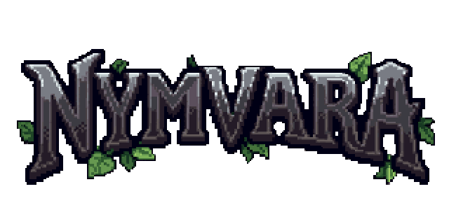

  

<h3 align="center">Ein Pixel-Rollenspiel im Browser. Mehrspieler, ohne Installation.</h3>

  

 

Du strandest auf der Ankerinsel und lernst bei sechs Ausbildern, was man zum Überleben braucht: Schürfen, Schmieden,
Holz, Angeln, Kochen, Kampf und Zauberei. Dann bringt dich das Boot nach **Thalund**, in Dörfer, Wälder, Burgen,
Gebirge und Grotten, die du mit anderen Spielern zusammen erkundest.

- ⚒️ Acht Fähigkeiten mit Stufen, Handwerk und Handel
- ✨ Zauber mit vier Energien und Seelensteinen
- 🗺️ Aufträge, Freundesliste, eine Welt für alle
- 🌍 Deutsch und Englisch

*A browser-based pixel RPG with multiplayer. Wash ashore, learn your trades, then set sail for Thalund. Play at [nymvara.io](https://nymvara.io).*
